# MuleWatch — Architecture, Component Breakdown & Operations Guide

> **IEEE-IGNITE Hackathon 2026 · Problem SKIT002**  
> **System**: MuleWatch (AI-Based Detection of Suspicious Financial Advertisements)  
> **Target Problem**: Detection, clustering, investigation, and takedown of money-mule supply chains, illicit bank account / SIM kit rentals, KYC fraud, and payment card sales across public platforms.

---

## 1. High-Level Architecture & Overview

MuleWatch is an autonomous, multi-tier intelligence system designed for cybercrime investigators and intelligence teams. It continuously monitors public discussion boards, social channels, and public Telegram channels, flags illicit financial recruitment and sale operations using a multi-signal hybrid scoring model, aggregates isolated posts into coordinated "seller rings" using graph clustering, and empowers investigators with real-time alerts, one-click takedown requests, and tamper-evident PDF reports.

```mermaid
flowchart TD
    subgraph INGESTION["1. Ingestion Sources"]
        CF["Charcha Forum (Local/Remote)"]
        TG["Telegram Public Channels (t.me/s/...)"]
        EXT["Chrome Extension (Right-Click/DOM)"]
        BOT["Telegram Citizen Bot (Reports/Forwards)"]
        MAN["Manual Investigator Submission"]
    end

    subgraph CRAWLER["2. Polling & Ingestion Worker"]
        CW["Crawler Loop (3s cycle)"]
        JSONLD["DiscussionForumPosting JSON-LD Parser"]
        IMGD["Image Downloader & Storage"]
    end

    subgraph PIPELINE["3. Intelligence Pipeline"]
        OCR["Tesseract OCR & Preprocessing"]
        ENT["Entity & Identifier Extractor"]
        LEX["Multilingual Obfuscation Lexicon"]
        NB["Naive Bayes Character N-Gram Model"]
        VIS["Visual Financial Cue Detector"]
        RULES["Explainable Heuristic Rule Engine"]
        FUSION["Noisy-OR Probabilistic Fusion"]
    end

    subgraph COORD["4. Coordination & Ring Detection"]
        MINHASH["MinHash LSH (Word 3-Shingles)"]
        PHASH["Image Perceptual Hash (Hamming <= 10)"]
        SHARED["Shared Identifiers (UPI/Phone/Telegram)"]
        UF["Union-Find Connected Components"]
    end

    subgraph PERSISTENCE["5. Persistence & Event Bus"]
        DB[(SQLite WAL Database)]
        SSE["Server-Sent Events (SSE) Stream"]
        TGALERT["Investigator Telegram Dispatcher"]
    end

    subgraph INTERFACES["6. User & Agent Interfaces"]
        DASH["React + Vite Command Center (:8001)"]
        SWAGGER["FastAPI REST API & Swagger (:8001/docs)"]
        PDF["ReportLab Evidence PDF Generator"]
        FORUM_UI["Charcha Public Board (:8100)"]
    end

    INGESTION --> CRAWLER
    CRAWLER --> PIPELINE
    PIPELINE --> COORD
    COORD --> PERSISTENCE
    PERSISTENCE --> INTERFACES
```



---

## 2. Core System Components

The project repository is split into four primary sub-systems:
1. **`backend/`**: FastAPI application, ML engine, heuristic rules, crawler, SQLite storage, and Telegram bot.
2. **`frontend/`**: Single-Page Application (React 18 + Vite) providing investigator dashboards, network graph, and case review.
3. **`forum/`**: "Charcha" — an authentic local reproduction of a public discussion community seeded with 50 realistic threads and 17 comments containing both benign discussions and disguised mule advertisements.
4. **`extension/`**: Chrome Manifest V3 extension enabling instant DOM and selection analysis from arbitrary websites.

---

## 3. Detailed Component Breakdown

### 3.1 Backend Modules (`backend/app/`)

#### 1. `main.py` — API Controller & Application Lifespan
- **Role**: Entry point for the FastAPI server.
- **Responsibilities**:
  - Registers startup lifecycle: initializes SQLite database (`init_db()`), fits/loads the Naive Bayes model (`ml.retrain()`), brings historical cases up to date (`rescore_all()`), and spawns background crawler and Telegram bot threads.
  - Mounts static media directory (`/media`) and frontend production bundle (`/` and static assets).
  - Implements REST endpoints:
    - `GET /api/posts`: Filterable case listings (by risk level, category, platform, search query, cluster).
    - `GET /api/posts/{id}`: Detailed breakdown of a specific post, matches, reasons, entities, and linked ring members.
    - `POST /api/check`: Ad-hoc scoring of raw text, remote URLs, or uploaded screenshots without saving to the database.
    - `POST /api/posts/{id}/feedback`: Human-in-the-loop feedback (`confirmed` vs `false_positive`), triggering immediate keyword weight updates and dynamic model retraining.
    - `POST /api/posts/{id}/takedown`: Signs an HMAC moderation token and issues a takedown request to the hosting forum.
    - `GET /api/graph`: Returns graph topology (nodes = cases, edges = shared identifiers, near-duplicate text, reposted images).
    - `GET /api/events`: Server-Sent Events (SSE) pushing new critical detections to connected clients in sub-second latency.
    - `GET /api/posts/{id}/report.pdf`: Streams dynamically generated court evidence PDFs.

#### 2. `crawler.py` — Autonomous Content Collector
- **Role**: Continuously ingests candidate material from monitored sources without requiring commercial API access.
- **Mechanisms**:
  - **`ForumCrawler`**: Polls `/new` on target forums every 3 seconds. Instead of fragile CSS scraping, it parses `schema.org/DiscussionForumPosting` JSON-LD embedded in forum HTML, extracting thread author, publication timestamp, post body, and comment trees.
  - **`TelegramPublic`**: Scrapes public Telegram channel previews via `https://t.me/s/<channel>` using standard HTTP requests, extracting text, timestamps, and image media.
  - **Deduplication**: Maintains URL and hash fingerprints to prevent duplicate ingestion cycles.

#### 3. `pipeline.py` — Central Intelligence Pipeline
- **Role**: Coordinates the ingestion sequence for any post (whether from the crawler, manual check, extension, or citizen bot).
- **Sequence**:
  1. Downloads and normalizes image files into `MEDIA_DIR`.
  2. Runs Tesseract OCR (`imaging.ocr_image()`) and calculates perceptual image hash (`imaging.phash()`).
  3. Executes `scoring.analyze()` to calculate component scores and noisy-OR fusion.
  4. Generates a cryptographic evidence fingerprint: `SHA-256(platform || author || url || text || ocr_text || posted_at || image_bytes)`.
  5. Computes coordination clusters (`coordination.compute()`), calculates ring risk boosts, and checks against watchlists (`scoring.finalize()`).
  6. Persists the `Post` record in SQLite.
  7. If risk exceeds configured threshold (`ALERT_MIN_LEVEL`), dispatches events via SSE and Telegram alerts (`alerts.maybe_alert()`).

#### 4. `scoring.py` — Explainable Hybrid Risk Engine
- **Role**: Evaluates the probability that a post represents an illicit financial transaction.
- **Scoring Equation**:
  The base risk score is computed using a **Noisy-OR** probabilistic combination:
  $$\text{BaseScore} = 1 - (1 - r) \times (1 - 0.75 \cdot m) \times (1 - 0.6 \cdot i) \times (1 - 0.8 \cdot l)$$
  Where:
  - $r \in [0, 1]$: Rule engine score (derived from keyword lexicon weights, combo bonuses, and entity presence).
  - $m \in [0, 1]$: Calibrated prediction probability from the Naive Bayes character n-gram text classifier.
  - $i \in [0, 1]$: Visual risk cues from image OCR and bank card visual detections.
  - $l \in [0, 1]$: Optional LLM second-opinion score (Claude / Gemini).
- **Feedback Adaptation (`term_multiplier`)**:
  Keyword weights are adjusted based on investigator feedback using Laplace-smoothed precision:
  $$\text{Multiplier} = 0.3 + 1.2 \times \frac{\text{conf} + 1}{\text{conf} + \text{fp} + 2}$$
  If an investigator repeatedly marks a keyword as a false positive, its score contribution drops automatically.
- **Coordination & Watchlist Floor (`finalize`)**:
  - Adds a coordination boost (+10 to +25 points) if the post belongs to a multi-member ring.
  - Forces score $\ge 88.0$ (Critical) if any extracted phone, UPI ID, or handle matches an active watchlist entry.

#### 5. `extract.py` — Multilingual Entity & Lexicon Engine
- **Role**: Normalizes obfuscated text and extracts structured cyber identifiers.
- **Capabilities**:
  - **Obfuscation Normalization**: Resolves leetspeak and punctuated evasion patterns (`acc0unt`, `a.t.m`, `r3ady`, `k-y-c`, `p_a_s_s_b_o_o_k`).
  - **Entity Extractors**:
    - Indian Mobile Numbers (10-digit formats with prefixes `+91`, `0`, and spaced groupings).
    - UPI IDs (`username@bank`, handles on Paytm, PhonePe, GooglePay, etc.).
    - Telegram links/handles (`t.me/...`, `@handle`).
    - WhatsApp click-to-chat links (`wa.me/...`).
    - Bank Card Numbers (16 digits with Luhn algorithm validation; auto-masked for evidence compliance).
    - IFSC Codes (RBI 11-character format).
    - Crypto Wallets (Bitcoin, Ethereum/USDT TRC-20 addresses).
    - URL domains and shorteners (`bit.ly`, `tinyurl.com`, `t.ly`).

#### 6. `ml.py` — Character N-Gram Naive Bayes Classifier
- **Role**: Language-agnostic, typo-resistant text classification.
- **Design**:
  - Extracts sub-word character n-grams ($n \in [3, 5]$).
  - Operates efficiently on Hinglish, Hindi transliterations, and deliberate spelling manipulations.
  - Trains in under 200ms on SQLite startup using the synthetic seed corpus (`backend/training/training_data.jsonl`) and dynamically updates whenever an investigator provides verdict feedback.

#### 7. `coordination.py` — Seller Ring & Coordination Graph
- **Role**: Unveils criminal syndicates operating across multiple accounts, channels, or platforms.
- **Three-Pillar Graph Linking**:
  1. **Near-Duplicate Text**: MinHash LSH over word 3-shingles with a Jaccard similarity threshold $\ge 0.5$.
  2. **Reposted / Reused Images**: Perceptual Hash (`imagehash.phash`) matching with Hamming distance $\le 10$ (catches cropped, resized, or color-adjusted images).
  3. **Shared Identifiers**: Common phone numbers, UPI handles, Telegram links, or WhatsApp contact points.
- **Algorithm**: Disjoint-set Union-Find (`UF`) connects all matching nodes into clusters, computing cluster size and cross-references.

#### 8. `reportbot.py` — Telegram Citizen Reporting & Alerts
- **Role**: Dual-purpose Telegram integration using zero-configuration long polling.
- **Features**:
  - **Citizen Reporting**: Citizens forward suspicious messages, screenshots, or channel links to the bot. The bot scans the content through the MuleWatch pipeline, replies in English & Hindi with risk analysis and cybercrime helpline info (1930 / cybercrime.gov.in), and files a case.
  - **Investigator Push**: Investigators link their private chat using a one-time pairing code (`/alerts <code>`). High & Critical cases are delivered immediately to the investigator's mobile device.

#### 9. `report.py` — Court-Ready Evidence PDF Generator
- **Role**: Compiles evidentiary dossiers using ReportLab.
- **Contents**: Post screenshot/image, extracted cyber entities, rule breakdown, ML confidence, coordination ring members, timeline, and cryptographic SHA-256 evidence verification hash.

#### 10. `db.py` — Persistence Layer
- **Role**: Relational storage using SQLAlchemy with SQLite WAL (Write-Ahead Logging) enabled.
- **Tables**:
  - `posts`: Full record of ingested posts, risk scores, entities, cluster IDs, and review verdicts.
  - `sources`: Monitored targets (forums, Telegram channels, custom links).
  - `watch_items`: High-priority target indicators (phones, UPIs, handles).
  - `reports`: Citizen report associations.
  - `keyword_stats`: Cumulative true-positive and false-positive counts per keyword.
  - `alerts`: Historical alert log.

---

### 3.2 Frontend Application (`frontend/`)

- Built with **React 18**, **Vite**, and plain modern CSS (`styles.css`).
- **Core Views**:
  - **Dashboard (`Dashboard.jsx`)**: System overview, KPI cards (Critical, High, Rings Detected, Takedowns), risk distribution bar, and live SSE alert ticker.
  - **Cases Ledger (`Cases.jsx`)**: Filterable table with search, category filtering, status tags, and bulk actions.
  - **Case Detail (`CaseDetail.jsx`)**: Full evidence viewer featuring side-by-side text/OCR analysis, entity highlighting, score component breakdowns, linked ring accounts, 1-click takedown execution, and PDF download.
  - **Network Graph (`Network.jsx` / `NetworkGraph.jsx`)**: Visual force-directed node-link graph mapping out seller rings and shared infrastructure.
  - **Manual Analysis (`Analyze.jsx`)**: Sandbox tester to evaluate arbitrary text, live URLs, or uploaded images without committing to the persistent ledger.
  - **Monitored Sources (`Sources.jsx` & `ReportBot.jsx`)**: Manage active crawlers, check Telegram citizen bot status, and display the pairing QR code.
  - **Watchlist Manager (`Watchlist.jsx`)**: Add/remove flagged phone numbers, UPI IDs, and Telegram handles.

---

### 3.3 Charcha Forum (`forum/`)

- Built with **FastAPI**, **Jinja2**, and **SQLite**.
- Simulates an active Indian public community with sub-forums: `c/PaisaTalk`, `c/CryptoDesi`, `c/DealsAndCoupons`, `c/TechHelp`, etc.
- Pre-seeded with 50 realistic threads and 17 comments (`seed_forum.py`).
- Emits schema.org `DiscussionForumPosting` JSON-LD on post pages.
- Supports authenticated moderator takedowns via `POST /api/mod/takedown`, placing a visible `[Content Withdrawn — Under Review by Cyber Crime Cell]` warning banner on flagged threads.

---

### 3.4 Chrome Browser Extension (`extension/`)

- Manifest V3 extension.
- Adds context menu: **"Scan selection with MuleWatch"** and **"Scan page with MuleWatch"**.
- Sends DOM text or selection directly to the MuleWatch API (`POST /api/check` or `POST /api/posts`), displaying an instant risk evaluation overlay in the popup.

---

## 4. How to Run the System

### 4.1 Prerequisites
- **Operating System**: macOS or Linux
- **Python**: Python 3.9, 3.10, 3.11, 3.12, or 3.13
- **Node.js**: v18+ (only needed if modifying frontend code; pre-built `dist/` is bundled)
- **Tesseract OCR**: (Optional but recommended for image text recognition)
  - macOS: `brew install tesseract tesseract-lang`
  - Linux: `sudo apt install -y tesseract-ocr tesseract-ocr-hin`

---

### 4.2 Quick Start (Single Command)

From the project root directory:

```bash
cd /Users/mahak/Desktop/Project/Amity/MuleWatch

# Copy environment configuration if not already present
[ -f .env ] || cp .env.example .env

# Run both the MuleWatch Command Center and the Local Charcha Forum
./run.sh --local-forum
```

#### What `run.sh` does automatically:
1. Detects available Python 3.9+ runtime.
2. Creates and manages the isolated virtual environment (`.venv`).
3. Installs backend and forum dependencies if not already satisfied.
4. Automatically finds a free port if port 8000 is occupied (e.g. falling back to 8001).
5. Seeds the local Charcha forum database if missing.
6. Starts both uvicorn servers simultaneously in the background.

---

### 4.3 Service Endpoints

| Service | URL | Notes |
|---|---|---|
| **MuleWatch Command Center** | `http://localhost:8001` (or `:8000`) | Main investigation UI |
| **FastAPI Interactive Docs** | `http://localhost:8001/docs` | Swagger UI for all REST endpoints |
| **ReDoc Documentation** | `http://localhost:8001/redoc` | Clean OpenAPI specification |
| **Local Charcha Forum** | `http://localhost:8100` | Target discussion board |

---

### 4.4 Alternative Run Options

- **Reset collected data and re-crawl from scratch**:
  ```bash
  ./run.sh --local-forum --reset
  ```
- **Specify explicit ports**:
  ```bash
  ./run.sh --local-forum --port 8080 --forum-port 8180
  ```
- **Allow access across Local Area Network (LAN)**:
  ```bash
  ./run.sh --local-forum --lan
  ```
- **Monitor an external forum server**:
  Edit `.env` and set `FORUM_URL=http://your-server-ip:8100`, then run:
  ```bash
  ./run.sh
  ```

---

## 5. Autonomous Agent Invocation & Programmatic API

Any AI agent or automated orchestration system can inspect, query, and manipulate MuleWatch using the standard REST API or by calling Python internals directly.

### 5.1 Programmatic REST API Workflows

#### 1. Checking System Health & Crawler Telemetry
```bash
curl -s http://localhost:8001/api/sources | jq .
```
Response:
```json
{
  "crawler": {
    "running": true,
    "last_cycle": "2026-10-14T07:30:24.313445",
    "errors": 0
  },
  "sources": [
    {
      "id": 1,
      "kind": "forum",
      "name": "Charcha public forum",
      "url": "http://localhost:8100",
      "items_seen": 67
    }
  ]
}
```

#### 2. Querying High & Critical Mule Cases
```bash
curl -s "http://localhost:8001/api/posts?level=Critical" | jq .
```

#### 3. Analyzing an Ad-Hoc Text or Suspicious Message (No DB Write)
```bash
curl -s -X POST http://localhost:8001/api/check \
  -H "Content-Type: application/json" \
  -d '{
    "text": "Need fresh current accounts for crypto transactions. Ready ATM + SIM kit. 50k weekly rent. Contact on TG @mule_supplier"
  }' | jq .
```

#### 4. Triggering a Takedown for a Flagged Post
```bash
curl -s -X POST http://localhost:8001/api/posts/12/takedown | jq .
```

#### 5. Providing Feedback to Retrain Model
```bash
# Mark as verified fraud
curl -s -X POST http://localhost:8001/api/posts/12/feedback \
  -H "Content-Type: application/json" \
  -d '{"label": "confirmed"}'

# Mark as false positive
curl -s -X POST http://localhost:8001/api/posts/15/feedback \
  -H "Content-Type: application/json" \
  -d '{"label": "false_positive"}'
```

#### 6. Retrieving Coordination Ring Graph
```bash
curl -s "http://localhost:8001/api/graph?min_score=30" | jq .
```

---

### 5.2 Direct Python Scripting / Agent Subprocess Invocation

Agents running Python inside the repository can interact directly with the pipeline modules:

```python
import sys
sys.path.append("backend")

from app.db import SessionLocal, Post
from app.pipeline import ingest
from app.scoring import analyze

# 1. Direct text analysis
analysis = analyze("HDFC current account with netbanking kit available for rent. DM on Telegram @fast_cash_hub")
print(f"Risk Score: {analysis['base_score']}")
print(f"Category: {analysis['reasons']}")
print(f"Entities: {analysis['entities']}")

# 2. Ingesting a new case into the database
with SessionLocal() as session:
    post = ingest(
        session,
        text="Selling pre-activated SIM cards and savings accounts. WhatsApp 9876543210",
        platform="Twitter/X",
        author="anonymous_seller",
        url="https://x.com/anon/status/123456"
    )
    print(f"Ingested Post ID: {post.id}, Final Score: {post.risk_score}")
```

---

## 6. Verification & Test Suite

The test suite covers entity extraction, lexicon matching, scoring equations, coordination clustering, and citizen bot reporting:

```bash
cd /Users/mahak/Desktop/Project/Amity/MuleWatch
.venv/bin/python -m unittest discover -s backend/tests -p "test_*.py"
```

To run model evaluation against the benchmark dataset:
```bash
.venv/bin/python backend/training/evaluate.py
```
Expected performance:
```text
TP: 19  FP: 0  TN: 48  FN: 0   Precision: 1.00  Recall: 1.00
```
